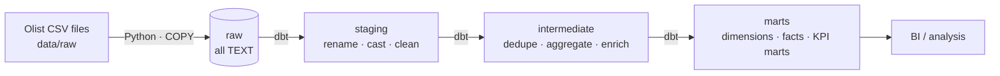

# E-commerce Logistics Data Pipeline

[](https://github.com/Diphaw/ecommerce-logistics-dbt-pipeline/actions/workflows/ci.yml)


An ELT pipeline that transforms the public [Olist Brazilian E-commerce dataset](https://www.kaggle.com/datasets/olistbr/brazilian-ecommerce)
into a tested dimensional model for **delivery and logistics analytics**. Raw files are loaded into
PostgreSQL with Python, then modelled with dbt into a layered warehouse (staging → intermediate → marts).

## Table of Contents

- [Business Context](#business-context)
- [Architecture](#architecture)
- [Tech Stack](#tech-stack)
- [Data Model](#data-model)
- [Project Structure](#project-structure)
- [Getting Started](#getting-started)
- [Configuration](#configuration)
- [Testing and Data Quality](#testing-and-data-quality)
- [Engineering Conventions](#engineering-conventions)
- [Design Decisions](#design-decisions)
- [Roadmap](#roadmap)

## Business Context

Late and costly deliveries are a leading driver of cancellations and poor reviews in e-commerce.
The marts in this project are built to answer questions such as:

- Which sellers have the highest late-delivery and cancellation rates?
- Which customer states have the worst on-time delivery performance, and is it improving month over month?
- How do seller-to-customer distance, freight cost and delivery delay relate to review scores?
- Where in the fulfilment chain (approval, seller handling, carrier transit) is time lost?

## Architecture



| Layer | Schema | Materialization | Responsibility |
|---|---|---|---|
| Ingestion | `raw` | Table (Python) | Land source files unchanged, idempotent reload, header contract validation |
| Staging | `staging` | View | One model per source table: rename, type-cast, normalise. No joins |
| Intermediate | `intermediate` | View | Reusable business logic: deduplication, rollups, geo centroids, distance |
| Marts | `marts` | Table | Star schema (`dim_*`, `fct_*`) and consumption-ready KPI marts (`mart_*`) |

## Tech Stack

| Concern | Tool |
|---|---|
| Storage / warehouse | PostgreSQL 15 (Docker) |
| Ingestion | Python, pandas, psycopg2 |
| Transformation and testing | dbt (`dbt-postgres`) |
| Orchestration of local workflow | Make |
| Code quality / CI | Ruff, GitHub Actions |

## Data Model

### Marts

| Model | Grain | Description |
|---|---|---|
| `dim_customers` | customer (per order) | State, city and geolocation centroid |
| `dim_sellers` | seller | State, city and geolocation centroid |
| `dim_products` | product | English category name, dimensions, derived volume |
| `dim_date` | calendar day | Calendar attributes across the order history |
| `fct_orders` | order | Item, payment and review summaries plus delivery lifecycle metrics |
| `fct_order_items` | order item | Price, freight, seller-to-customer distance (haversine) |
| `mart_logistics__seller_performance` | seller | GMV, late-delivery rate, handling time, review score, cancellation rate |
| `mart_logistics__delivery_performance_monthly` | purchase month × customer state | On-time rate, average delivery and transit days, freight, review score |

### Key delivery metrics (`fct_orders`)

| Column | Definition |
|---|---|
| `approval_hours` | Purchase → payment approval |
| `seller_handling_days` | Approval → handed to carrier |
| `carrier_transit_days` | Handed to carrier → delivered to customer |
| `delivery_days` | Purchase → delivered to customer |
| `delivery_delay_days` | Calendar days past the estimated date (negative = early) |
| `is_late` / `is_severely_late` | Delay > 0 days / delay > `severe_delay_threshold_days` (dbt var, default 7) |

Metrics are `NULL` until the corresponding milestone occurs; rates only count orders that have the relevant data.

## Project Structure

```
.
├── data/raw/                       # Source CSVs (git-ignored)
├── ingestion/
│   ├── config.py                   # DB settings and per-file source contracts
│   └── load_raw.py                 # CSV → PostgreSQL loader
├── dbt_olist_logistics/
│   ├── models/
│   │   ├── staging/olist/          # stg_olist__<entity>
│   │   ├── intermediate/           # int_<entity>__<verb>
│   │   └── marts/
│   │       ├── core/               # dim_*, fct_*
│   │       └── logistics/          # mart_logistics__*
│   ├── macros/                     # schema naming, date diffs, haversine
│   ├── tests/                      # singular data tests
│   ├── dbt_project.yml
│   └── profiles.yml                # env-var driven, contains no secrets
├── .github/workflows/ci.yml        # Lint and dbt parse
├── docker-compose.yml              # PostgreSQL service
├── Makefile                        # Developer entrypoints
├── pyproject.toml                  # Ruff configuration
└── requirements*.txt
```

## Getting Started

### Prerequisites

- Python 3.10+ (with the `venv` module)
- Docker and Docker Compose
- The Olist CSV files from [Kaggle](https://www.kaggle.com/datasets/olistbr/brazilian-ecommerce), placed in `data/raw/`

### Run the pipeline

```bash
git clone https://github.com/Diphaw/ecommerce-logistics-dbt-pipeline.git
cd ecommerce-logistics-dbt-pipeline

cp .env.example .env     # set DB_PASSWORD
make setup               # create virtualenv and install dependencies
make up                  # start PostgreSQL
make pipeline            # ingest raw data, then dbt build (models + tests)
make dbt-docs            # browse lineage and column documentation
```

### Make targets

| Target | Description |
|---|---|
| `make setup` | Create the virtualenv and install dependencies |
| `make up` / `make down` | Start / stop PostgreSQL (the data volume is kept) |
| `make ingest` | Load raw CSVs into the `raw` schema |
| `make dbt-build` | Build models and run tests in DAG order |
| `make dbt-test` | Run tests only |
| `make dbt-docs` | Generate and serve dbt docs |
| `make pipeline` | `ingest` followed by `dbt-build` |
| `make lint` / `make format` | Lint / auto-format Python code |

## Configuration

All settings are read from environment variables (see [`.env.example`](.env.example)). The `.env` file is git-ignored.

| Variable | Default | Description |
|---|---|---|
| `DB_USER` | `postgres` | Database user |
| `DB_PASSWORD` | – (required) | Database password |
| `DB_HOST` | `localhost` | Database host |
| `DB_PORT` | `5435` | Host port mapped to PostgreSQL |
| `DB_NAME` | `olist_logistics_db` | Database name |

## Testing and Data Quality

`dbt build` runs every model followed by its tests.

- **Generic tests:** every primary key is `unique` and `not_null`; foreign keys use `relationships`; enumerations use `accepted_values`.
- **Singular tests** (`dbt_olist_logistics/tests/`): payment reconciliation, chronological order milestones, valid rate ranges and mart grain.
- **Severity policy:** violations of rules owned by this project fail the build. Known upstream data anomalies are reported as `warn` instead of being silently dropped.
- **Ingestion checks:** CSV headers are validated against the declared contract, and loaded row counts are compared with rows read.

Known characteristics of the source data and how they are handled:

| Observation | Handling |
|---|---|
| `review_id` is not unique and orders can have several reviews | Keep the most recent review per order (`int_orders__latest_review`) |
| Some products are uncategorised or untranslated | Fall back to the Portuguese name, then `unknown` |
| Many geolocation rows per zip prefix | Collapse to a centroid; distance is `NULL` when a prefix has no geolocation |
| Delivered orders without a delivery timestamp, out-of-order timestamps | Surfaced by warn-level tests |
| Estimated delivery dates are date-only | Lateness is measured in whole calendar days |

## Engineering Conventions

- **Naming:** `stg_<source>__<entity>`, `int_<entity>__<verb>`, `dim_<entity>`, `fct_<entity>`, `mart_<domain>__<name>`.
- **Documentation:** one `_<folder>__models.yml` per model folder, with column descriptions and tests next to the models they describe.
- **Idempotency:** re-running ingestion or dbt always produces the same state.
- **Schemas:** custom schema names are used verbatim (`staging`, `intermediate`, `marts`) via an overridden `generate_schema_name` macro.
- **Secrets:** never committed; configuration comes from environment variables.
- **Commits:** [Conventional Commits](https://www.conventionalcommits.org/) (`feat:`, `fix:`, `chore:`, `docs:`, `refactor:`).

## Design Decisions

- **ELT over ETL.** Raw data lands untouched and all transformation lives in version-controlled, tested SQL.
- **All-`TEXT` raw layer.** Typing is deferred to staging so malformed values never break ingestion and upstream quirks remain inspectable.
- **`TRUNCATE` + `COPY` in one transaction.** Fast bulk loading, atomic per table, and dbt views that depend on raw tables are never dropped.
- **Views for staging/intermediate, tables for marts.** No storage overhead for lightweight layers; fast reads for consumers.

## Roadmap

- [ ] dbt model contracts and constraints on marts
- [ ] Incremental models for fact tables
- [ ] Orchestration with Airflow or Dagster
- [ ] BI dashboard on top of the logistics marts
- [ ] Unit tests for macros and key business logic

## Data Source

[Olist Brazilian E-commerce Public Dataset](https://www.kaggle.com/datasets/olistbr/brazilian-ecommerce), released by Olist under CC BY-NC-SA 4.0.
