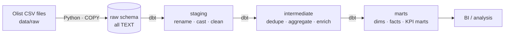

# E-commerce Logistics Data Pipeline (Olist · PostgreSQL · dbt)

An ELT pipeline that turns the public [Olist Brazilian E-commerce dataset](https://www.kaggle.com/datasets/olistbr/brazilian-ecommerce)
(~100k orders, 9 tables) into a tested dimensional model for **delivery and logistics analytics**:
Which sellers ship late? Which states have the worst on-time rate? How does seller-to-customer
distance affect delivery time and customer satisfaction?

## Architecture



| Layer | Schema | Materialization | Responsibility |
|---|---|---|---|
| Ingestion | `raw` | table (Python) | Land source files untouched (all `TEXT`), idempotent reload, header contract check |
| Staging | `staging` | view | 1:1 with sources: rename, type-cast, trim/normalise. No joins |
| Intermediate | `intermediate` | view | Reusable business logic: review dedup, payment/item rollups, geo centroids, distance |
| Marts | `marts` | table | Star schema (`dim_*`, `fct_*`) and consumption-ready KPI marts (`mart_*`) |

## Data model (marts)

| Model | Grain | Purpose |
|---|---|---|
| `dim_customers`, `dim_sellers`, `dim_products`, `dim_date` | one row per entity / day | Conformed dimensions |
| `fct_orders` | order | Items, payments, review and delivery lifecycle metrics (`delivery_days`, `delivery_delay_days`, `is_late`, ...) |
| `fct_order_items` | order item | Price, freight, seller-to-customer distance (haversine) |
| `mart_logistics__seller_performance` | seller | GMV, late-delivery rate, handling time, review score, cancellation rate |
| `mart_logistics__delivery_performance_monthly` | purchase month × customer state | On-time rate, average delivery/transit days, freight, review score |

## Project structure

```
.
├── data/raw/                      # Source CSVs (git-ignored)
├── ingestion/                     # Python EL: config (source contracts) + loader
├── dbt_olist_logistics/
│   ├── models/
│   │   ├── staging/olist/         # stg_olist__<entity>
│   │   ├── intermediate/          # int_<entity>__<verb>
│   │   └── marts/{core,logistics}/ # dim_*, fct_*, mart_logistics__*
│   ├── macros/                    # schema naming, date diffs, haversine
│   └── tests/                     # singular data tests
├── docker-compose.yml             # PostgreSQL 15
├── Makefile                       # Developer entrypoints
└── .github/workflows/ci.yml       # Lint + dbt parse
```

### Conventions

- **Naming:** `stg_<source>__<entity>`, `int_<entity>__<verb>`, `dim_`/`fct_`/`mart_<domain>__<name>`; YAML files prefixed with `_` and one per folder.
- **Idempotency:** re-running ingestion or dbt always yields the same state.
- **Testing:** every primary key is `unique` + `not_null`, foreign keys use `relationships`, enumerations use `accepted_values`. Business-rule checks live in `tests/`; known upstream data anomalies are `warn`, not `error`.
- **Secrets:** configuration comes from environment variables (`.env`, git-ignored); `.env.example` is committed.

## Getting started

Prerequisites: Python 3.10+, Docker.

```bash
cp .env.example .env        # then set DB_PASSWORD
make setup                  # venv + dependencies
# place the Olist CSVs in data/raw/
make up                     # start PostgreSQL
make pipeline               # ingest raw data, then dbt build (models + tests)
make dbt-docs               # browse lineage and column docs
```

`make help` lists all commands.

## Data quality notes

Findings from profiling the dataset, and how the pipeline handles them:

- `review_id` is not unique and some orders have several reviews → keep the latest review per order.
- Some products have no category or an untranslated one → fall back to the Portuguese name, then `unknown`.
- Many geolocation rows per zip prefix → collapsed to a centroid; distance is `NULL` when a prefix is missing.
- Orders can be delivered without a delivery timestamp, and a few timestamps are out of order → surfaced by warn-level tests rather than silently dropped.
- Estimated delivery dates are date-only, so lateness is measured in whole calendar days.

